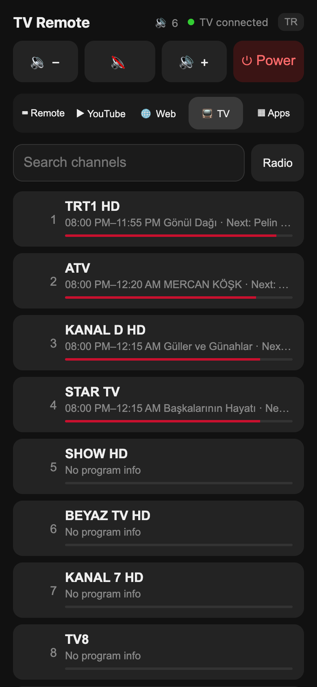

# LG TV Web Remote

A small local server that lets you control an LG webOS TV from your phone's browser. No app to install: on the same Wi-Fi, just open **http://kumanda.local** on your phone.

Built and tested with an LG C4 (OLED55C46LA, webOS 24). Older webOS TVs (2014–2017) are supported in code: the server falls back from `wss://TV:3001` to `ws://TV:3000`, loads app icons over HTTP and uses a corner toast for notifications. These paths haven't been tested on a real older set yet, so reports are welcome.

<p align="center">
  
  
  
  
  
</p>

## Features

- **Keyboard**: Text you type on the phone goes straight into the TV's text field. Deletes, Enter and autocorrect are kept in sync.
- **YouTube**: Search on your phone and tap a result to play it in the TV's YouTube app. YouTube draws its own on-screen keyboard, so typing text doesn't reach it; this tab fills that gap.
- **Web**: Type an address to open it in the TV browser, or anything else to search the web (Yandex by default, configurable). Paste a YouTube link and it opens in the YouTube app. A **touchpad** controls the browser cursor: drag to move, tap to click, two fingers to scroll.
- **Apps**: Every app and HDMI input on the TV, with icons. Tap to open.
- **Live TV channels**: The TV's channel list with search and a radio toggle. Each channel shows what's on now, a progress bar and what's next, from the TV's own program guide. Tap a channel to switch to it.
- **Remote**: Arrow keys, OK, Back, Home, Settings and media keys (⏪ ▶ ⏸ ⏩).
- **Volume and power**: Volume up/down, mute and a live volume level. The power button turns the TV off, or wakes it with Wake-on-LAN when it's off.
- **English and Turkish**: The interface follows your phone's language. Switch it with the TR/EN button in the header; the choice is remembered.

The TV's IP and MAC address are discovered automatically: SSDP first, then mDNS (the TV's AirPlay advertisement), with the MAC address read from the ARP table. The last address found is remembered, because TVs in standby stop announcing themselves.

## TV settings

1. Turn on **Settings → General → Devices → External Devices → TV On With Mobile → Turn on via Wi-Fi**. Without it, the power button can turn the TV off but not back on.
2. The first time the server connects, the TV shows a connection request. Press **Accept** on the remote. The pairing key is saved, so you only do this once.

## Installation

### As a Home Assistant add-on (recommended)

The server runs alongside Home Assistant and starts automatically on boot.

[](https://my.home-assistant.io/redirect/supervisor_add_addon_repository/?repository_url=https%3A%2F%2Fgithub.com%2Fenesigneci%2Flg-tv-web-remote)

1. Click the button above, or in Home Assistant go to **Settings → Add-ons → Add-on Store → ⋮ → Repositories** and add `https://github.com/enesigneci/lg-tv-web-remote`.
2. Install and start the **LG TV Web Remote** add-on.
3. Open **http://kumanda.local** on your phone. If the name doesn't resolve, use your Home Assistant IP address.

The add-on's **Documentation** tab covers setup, options and troubleshooting.

Options on the add-on's **Configuration** tab:

| Option | Description |
| --- | --- |
| `tv_host` | The TV's IP address. Leave empty for auto-discovery. |
| `tv_mac` | The TV's MAC address for Wake-on-LAN. Leave empty for auto-discovery. |
| `hostname` | Name announced on the network. Defaults to `kumanda.local`. |
| `port` | Web server port. Defaults to `80`. |
| `search_engine` | Engine used for web searches: `yandex` (default), `google`, `duckduckgo` or `bing`. |

#### Inside Home Assistant

The remote also opens inside Home Assistant through ingress, so it works wherever Home Assistant does, including away from home through your remote access URL, and behind Home Assistant's login.

- **Sidebar**: Turn on **Show in sidebar** on the add-on's **Info** tab to get a **TV Remote** entry.
- **Dashboard card**: Add a button that opens the remote:

  ```yaml
  type: button
  name: TV Remote
  icon: mdi:remote-tv
  tap_action:
    action: navigate
    navigation_path: /local_tv_kumanda
  ```

  The path is the add-on's slug, which is also the sidebar entry's address: `local_tv_kumanda` when the add-on is installed from a local folder, `<repository id>_tv_kumanda` when it's installed from the GitHub repository.

### On a computer (macOS, Linux, Raspberry Pi)

Requires Node.js 18 or newer.

```bash
cd tv_kumanda
npm install
npm start
```

Port 80 works out of the box on macOS but needs privileges on Linux. Pick another port there:

```bash
PORT=8080 npm start
```

Environment variables: `TV_HOST`, `TV_MAC`, `PORT`, `MDNS_NAME`, `KEY_FILE`, `SEARCH_ENGINE`. You can also pass the TV's IP as an argument: `node server.js 192.168.1.50`.

## Notifications on the TV

The **Message on TV** box at the bottom of the Remote tab sends a message with an optional title, and you can choose how long it stays on screen. The same thing is available as an HTTP endpoint: `POST /notify` shows a message in the middle of the TV screen that closes itself after a few seconds:

```bash
curl -X POST http://kumanda.local/notify -H 'Content-Type: application/json' \
  -d '{"title": "Dishwasher", "message": "Done!", "seconds": 10}'
```

From Home Assistant, add a `rest_command` and call it from any automation:

```yaml
rest_command:
  tv_notify:
    url: http://kumanda.local/notify
    method: POST
    content_type: application/json
    payload: >-
      {"title": {{ title | default("") | tojson }}, "message": {{ message | tojson }}, "seconds": {{ seconds | default(15) }}}
```

## How it works

- The server talks to the TV over the **webOS SSAP** protocol (`wss://TV:3001`, falling back to `ws://TV:3000` on older sets) using the [lgtv2](https://github.com/hobbyquaker/lgtv2) library. Text goes through `com.webos.service.ime`; keys and the touchpad use the network input socket.
- YouTube videos are sent with the **YouTube Lounge API**, the same mechanism the YouTube phone app uses for "Play on TV". The TV's screen ID comes from DIAL.
- The `kumanda.local` name is announced by an mDNS responder running inside the server, so there's no need to rename your computer or Home Assistant host.

## Security

The `tv-key` file is the pairing key that grants control of your TV. It's listed in `.gitignore`; don't share it. The server has no authentication: anyone on your home network can use the remote. Don't expose it to the internet.

## License

MIT
